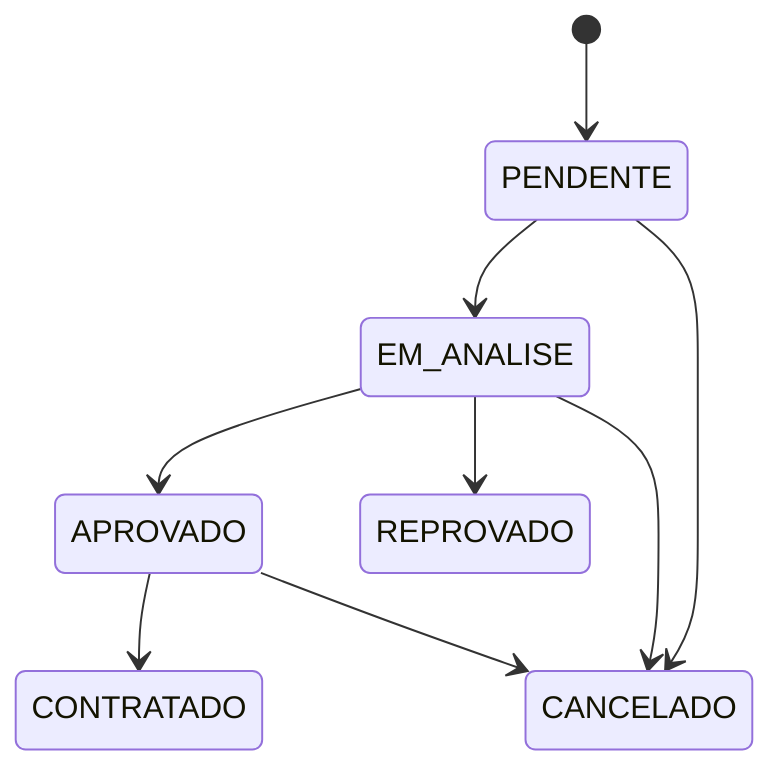
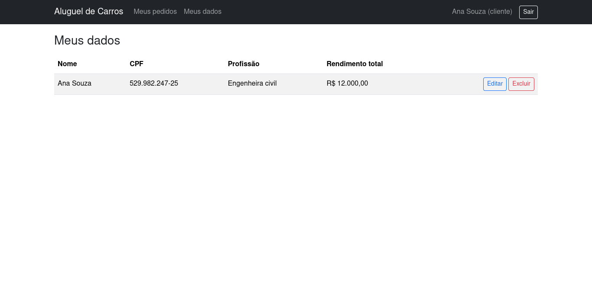
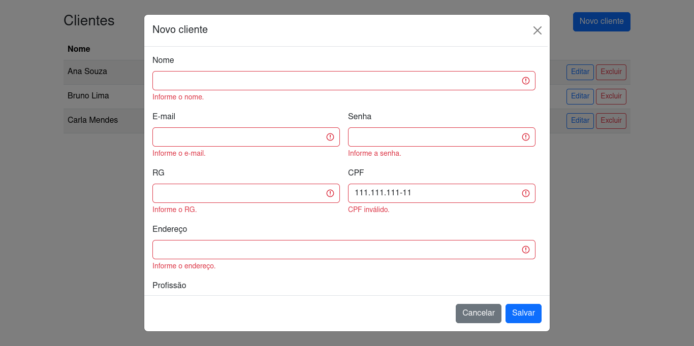
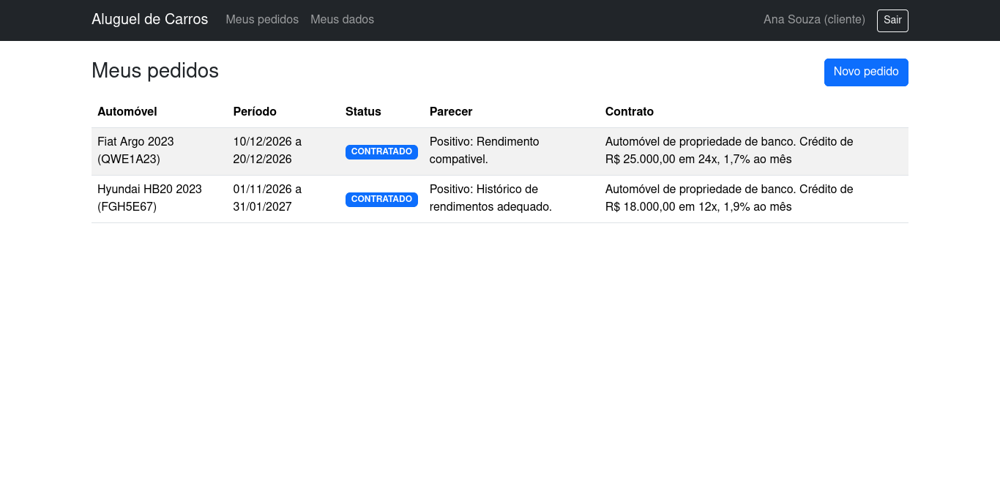
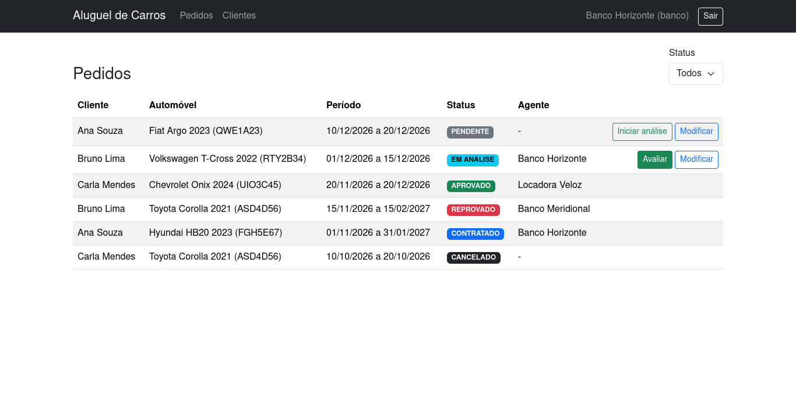
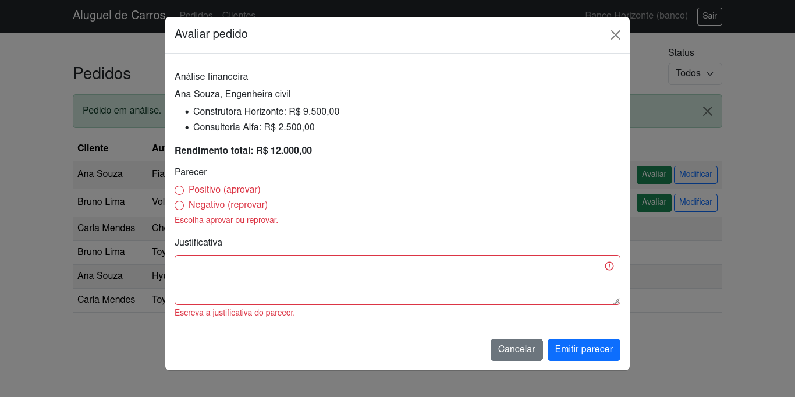
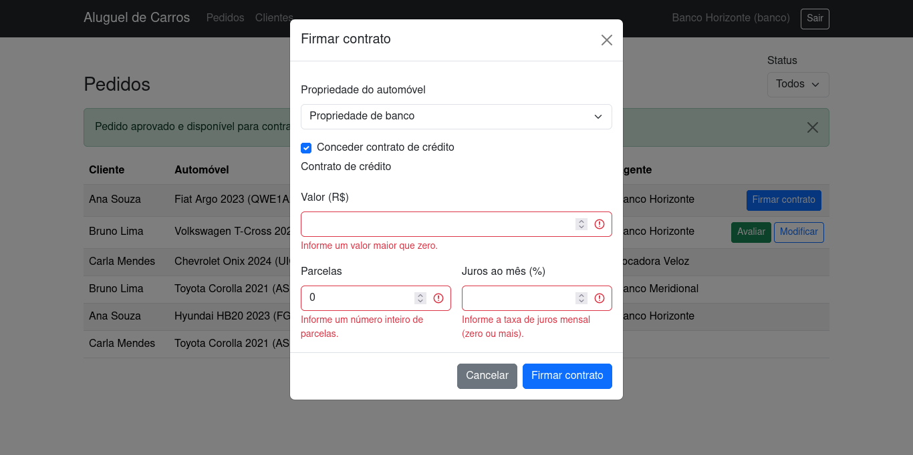

# Sistema de Aluguel de Carros

> LAB02 da disciplina Desenvolvimento de Interfaces Web (PUC Minas), 15 pontos.

| Disciplina | Professor | Curso |
|------------|-----------|-------|
| Desenvolvimento de Interfaces Web | João Paulo Carneiro Aramuni | Engenharia de Software, 2º semestre |

## Status do Projeto

Protótipo funcional concluído: modelagem, CRUD de Cliente, login simulado, pedidos, avaliação por agentes e contratos. 77 testes automatizados passando (`npm test`).

## Índice

- [Links Úteis](#links-úteis)
- [Sobre o Projeto](#sobre-o-projeto)
- [Funcionalidades Principais](#funcionalidades-principais)
- [Tecnologias Utilizadas](#tecnologias-utilizadas)
- [Arquitetura](#arquitetura)
- [Instalação e Execução](#instalação-e-execução)
- [Deploy](#deploy)
- [Estrutura de Pastas](#estrutura-de-pastas)
- [Demonstração](#demonstração)
- [Testes](#testes)
- [Documentações utilizadas](#documentações-utilizadas)
- [Autores](#autores)
- [Contribuição](#contribuição)
- [Agradecimentos](#agradecimentos)
- [Licença](#licença)
- [Estratégia de branches](#estratégia-de-branches)
- [Histórico de alterações](#histórico-de-alterações)

## Links Úteis

- Repositório: https://github.com/Arthur-Bicalho/DIW-Lab2
- Glossário do domínio: [GLOSSARY.md](GLOSSARY.md)
- Especificação: [docs/SPEC.md](docs/SPEC.md)
- Decisões de arquitetura: [docs/adr](docs/adr)
- Progresso, checklist de requisitos e roteiro da apresentação: [docs/PROGRESSO.md](docs/PROGRESSO.md)
- Diagramas UML (Mermaid, renderizados pelo GitHub):
  - [Casos de uso](docs/diagramas/casos-de-uso.md)
  - [Histórias de usuário](docs/historias-de-usuario.md)
  - [Classes e estados do Pedido](docs/diagramas/classes.md)
  - [Pacotes](docs/diagramas/pacotes.md)
  - [Componentes](docs/diagramas/componentes.md)

Não há demonstração online nem aplicativo móvel: o sistema roda localmente.

## Sobre o Projeto

Sistema web para gerenciar aluguéis de automóveis. Pedidos de aluguel são criados, modificados e cancelados pela Internet. Depois de enviado, o Pedido passa por uma análise financeira feita por um Agente (Empresa ou Banco); com Parecer positivo, fica disponível para a execução do Contrato, que pode incluir um Contrato de Crédito concedido por um Banco.

A arquitetura é cliente-servidor: um servidor central (JSON Server) acessado pelos navegadores de clientes e agentes. O código se divide nos dois subsistemas pedidos no enunciado: gestão de pedidos e contratos, e construção dinâmica das páginas web.

O uso exige cadastro e login. O login é **simulado**: os usuários ficam no `db.json` com senha em texto puro e a sessão no `sessionStorage`. Não é autenticação real, e o JSON Server não impõe autorização; as permissões por perfil valem apenas na interface ([ADR 0004](docs/adr/0004-login-simulado-e-perfis.md)).

## Funcionalidades Principais

**Cliente (pessoa física)**
- Cadastro público com RG, CPF, nome, endereço, profissão e até 3 entidades empregadoras, cada uma com rendimento.
- Consulta, alteração e exclusão dos próprios dados (CRUD de Cliente). A exclusão é recusada se houver Pedido em andamento.
- Criação de Pedidos de aluguel (Automóvel e período), consulta de status e Parecer, modificação (somente PENDENTE) e cancelamento (até APROVADO).
- Consulta do Contrato do Pedido, com a propriedade do automóvel e o crédito.

**Empresa e Banco (Agentes)**
- Lista de Pedidos com filtro por status e consulta dos Clientes.
- Início da análise de um Pedido PENDENTE, que passa a EM_ANALISE e fica atribuído ao Agente.
- Avaliação com vista dos rendimentos e Parecer com justificativa: positivo aprova, negativo reprova.
- Modificação de Pedidos PENDENTE ou EM_ANALISE.
- Execução do Contrato de Pedido APROVADO, escolhendo o Tipo de Propriedade do Automóvel (Cliente, Empresa ou Banco).

**Somente Banco**
- Concessão de Contrato de Crédito (valor, parcelas e juros mensais) ao firmar o Contrato.

### Fluxo de status do Pedido



O fluxo separa EM_ANALISE de PENDENTE para registrar qual Agente assumiu o Pedido e impedir avaliações concorrentes, e só permite cancelar antes da execução do Contrato, como diz o enunciado. Justificativa completa em [ADR 0001](docs/adr/0001-fluxo-de-status-do-pedido.md) e [ADR 0002](docs/adr/0002-agente-avalia-pedidos.md).

## Tecnologias Utilizadas

### Front-end
- HTML5, CSS3 e JavaScript puro com módulos ES, sem frameworks.
- Bootstrap 5.3 via CDN.
- Fetch API, centralizada em `src/shared/api.js`.

### Back-end
- JSON Server 1.0.0-beta.15 como API REST simulada, persistindo em `db.json`, e também servindo os arquivos estáticos.

### Mobile (Opcional)
Não se aplica. O layout é responsivo (Bootstrap), sem aplicativo nativo.

### Infraestrutura & DevOps
- Node.js e npm; testes com o executor nativo `node --test`.
- Git e GitHub: Issues, Pull Requests e merge sem squash.

## Arquitetura

As pastas de `src/` espelham os diagramas de pacotes e de componentes.

| Subsistema (enunciado) | Pasta | Papel |
|------------------------|-------|-------|
| Gestão de pedidos e contratos | `src/pedidos-contratos` | `models` (constantes), `regras` (funções puras: validações, transições, permissões), `services` (acesso à API) |
| Construção dinâmica das páginas | `src/paginas` | `views` (uma por tela) e `components` (peças reutilizáveis) |
| Infraestrutura comum | `src/shared` | `api.js` (Fetch), `sessao.js`, `alertas.js` |

| Classe do diagrama de classes | Onde está no código |
|-------------------------------|---------------------|
| Usuario, Cliente, EntidadeEmpregadora | `regras/cliente.js`, `services/clienteService.js`, `services/usuarioService.js` |
| Agente, Empresa, Banco | perfis em `models/constantes.js`; permissões em `regras/permissoes.js` |
| Pedido, Parecer | `regras/pedido.js`, `services/pedidoService.js` |
| Contrato, ContratoCredito | `regras/contrato.js`, `services/contratoService.js` |
| Automovel | `services/automovelService.js` |

A lógica de negócio fica em módulos puros (`regras`), sem DOM, e é testada com `node --test`. Todas as chamadas Fetch passam pelo serviço; falhas aparecem em alertas Bootstrap.

### Exemplos de diagramas

| Diagrama | Arquivo |
|----------|---------|
| Casos de uso | [docs/diagramas/casos-de-uso.md](docs/diagramas/casos-de-uso.md) |
| Classes | [docs/diagramas/classes.md](docs/diagramas/classes.md) |
| Pacotes | [docs/diagramas/pacotes.md](docs/diagramas/pacotes.md) |
| Componentes | [docs/diagramas/componentes.md](docs/diagramas/componentes.md) |

Os diagramas são mantidos junto com o código: toda mudança de estrutura atualiza o diagrama afetado e entra no [histórico de alterações](#histórico-de-alterações).

## Instalação e Execução

### Pré-requisitos
- Node.js 20 ou superior e npm.
- Um navegador atual.

### Variáveis de Ambiente
Nenhuma. A API roda em `http://localhost:3000`.

### Instalação de Dependências

```bash
npm install
```

### Inicialização do Banco de Dados
O banco é o arquivo `db.json`, versionado com dados de exemplo (3 clientes, 1 empresa, 2 bancos, 6 automóveis, 6 pedidos em todos os status e 1 contrato). Para voltar ao estado inicial depois de testar: `git checkout db.json`.

### Como Executar a Aplicação

```bash
npm start
```

O comando sobe o JSON Server em `http://localhost:3000`, que serve a API (`/usuarios`, `/automoveis`, `/pedidos`, `/contratos`) e as páginas. Abra http://localhost:3000/public/login.html.

Usuários de exemplo (senha `123456` para todos):

| Perfil | E-mail |
|--------|--------|
| Cliente | ana@email.com, bruno@email.com, carla@email.com |
| Empresa | veloz@empresa.com |
| Banco | horizonte@banco.com, meridional@banco.com |

Também é possível criar um Cliente em `public/cadastro.html`.

## Deploy
Não há deploy. O sistema é um protótipo acadêmico executado localmente.

## Estrutura de Pastas

```text
.
├── db.json                          # banco simulado
├── GLOSSARY.md                      # linguagem do domínio
├── public/                          # páginas HTML (login, cadastro, clientes, meus-pedidos, avaliacao)
├── src/
│   ├── shared/                      # api.js, sessao.js, alertas.js
│   ├── pedidos-contratos/           # subsistema: gestão de pedidos e contratos
│   │   ├── models/                  # constantes
│   │   ├── regras/                  # cliente, pedido, contrato, permissoes, formatacao, erros
│   │   └── services/                # clienteService, usuarioService, pedidoService, contratoService, automovelService
│   └── paginas/                     # subsistema: construção dinâmica das páginas
│       ├── views/                   # login, cadastro, clientes, pedidos, avaliacao
│       └── components/              # navbar, guarda, tabela, formulários, diálogos
├── tests/                           # node --test (espelha regras e services)
└── docs/                            # SPEC, ADRs, diagramas, histórias, capturas, PROGRESSO
```

A página do Cliente se chama `meus-pedidos.html` porque o JSON Server serviria `public/pedidos.html` em `/pedidos`, escondendo a API.

## Demonstração

### Aplicativo Mobile
Não se aplica.

### Aplicação Web

| Tela | Captura |
|------|---------|
| Meus dados (Cliente) |  |
| Validação do formulário de Cliente |  |
| Pedidos do Cliente, com contrato |  |
| Lista de Pedidos do Agente |  |
| Parecer sem justificativa |  |
| Contrato de Crédito (Banco) |  |

### Exemplo de Saída no Terminal

#### 1. Demonstração da API

```bash
curl http://localhost:3000/pedidos/5
```

Devolve o Pedido 5 (CONTRATADO) em JSON.

#### 2. Demonstração de Execução de CLI/Script

```bash
npm test
```

Executa os 77 testes e termina com `fail 0`.

## Testes

### Testes Unitários e de Integração
`npm test` roda `node --test` sobre `tests/`:
- regras puras: CPF, campos obrigatórios, limite de 3 entidades empregadoras, transições de status, permissões por perfil, Parecer, Contrato e Contrato de Crédito;
- serviços, com um JSON Server simulado em memória (`tests/apoio/bancoFalso.js`), cobrindo duplicidade de CPF e e-mail, disponibilidade do Automóvel, autorização por Agente e um Contrato por Pedido.

### Testes End-to-End (E2E)
Não há suíte E2E automatizada. Os fluxos de tela (cadastro, login, guarda de rota, pedidos, avaliação e contratos) foram verificados manualmente no navegador a cada branch, e as capturas ficam em `docs/capturas`.

### Limitações conhecidas
- Login simulado, sem autorização no servidor.
- O JSON Server v1 não casa filtros numéricos com ids em texto, por isso `recurso.listar` filtra no cliente ([ADR 0007](docs/adr/0007-filtros-no-cliente.md)).
- Sem controle de versão nem transações: dois Agentes que iniciam a análise ao mesmo tempo podem se sobrescrever, e `firmar` grava Contrato, Pedido e Automóvel em três chamadas.
- A disponibilidade do Automóvel considera Pedido ativo, não sobreposição de datas.

## Documentações utilizadas

- [Bootstrap 5.3](https://getbootstrap.com/docs/5.3/)
- [JSON Server](https://github.com/typicode/json-server)
- [Fetch API (MDN)](https://developer.mozilla.org/pt-BR/docs/Web/API/Fetch_API)
- [Executor de testes do Node.js](https://nodejs.org/api/test.html)
- [Mermaid](https://mermaid.js.org/)

## Autores

| Nome | GitHub |
|------|--------|
| Arthur Bicalho | [@Arthur-Bicalho](https://github.com/Arthur-Bicalho) |

## Contribuição

1. Faça um fork e crie uma branch a partir de `main` (`feature/...`, `docs/...`, `refactor/...`).
2. Commits em português seguindo Conventional Commits, por exemplo `feat(pedido): adiciona cancelamento`.
3. Atualize o diagrama afetado na mesma branch.
4. Rode `npm test` e abra um Pull Request que feche a Issue correspondente.

## Agradecimentos

Ao professor João Paulo Carneiro Aramuni, pelo enunciado e pelo template de documentação.

## Licença

MIT.

## Estratégia de branches

`main` permanece estável. Cada entrega tem uma Issue e uma branch criada a partir de `main` atualizada, com Pull Request que fecha a Issue e merge sem squash (o histórico mostra a evolução dos modelos e do código); a branch é apagada depois do merge.

Prefixos: `docs/` (modelagem e documentação), `feature/` (funcionalidades) e `refactor/` (revisões de arquitetura).

## Histórico de alterações

| PR | Branch | Mudança | Diagramas afetados |
|----|--------|---------|--------------------|
| [#12](https://github.com/Arthur-Bicalho/DIW-Lab2/pull/12) | `docs/setup-projeto` | Especificação, `.gitignore`, ADR 0000 | nenhum |
| [#13](https://github.com/Arthur-Bicalho/DIW-Lab2/pull/13) | `docs/modelagem-casos-de-uso-historias` | Glossário, ADRs 0001 a 0005, casos de uso, histórias | casos de uso criado |
| [#14](https://github.com/Arthur-Bicalho/DIW-Lab2/pull/14) | `docs/diagrama-classes-pacotes` | Diagramas de classes e de pacotes | classes e pacotes criados |
| [#15](https://github.com/Arthur-Bicalho/DIW-Lab2/pull/15) | `docs/diagrama-componentes` | Diagrama de componentes | componentes criado |
| [#16](https://github.com/Arthur-Bicalho/DIW-Lab2/pull/16) | `feature/setup-json-server` | `package.json`, `db.json`, `shared/api.js`, constantes | nenhum |
| [#17](https://github.com/Arthur-Bicalho/DIW-Lab2/pull/17) | `feature/crud-cliente` | CRUD de Cliente, validações, serviço | nenhum |
| [#19](https://github.com/Arthur-Bicalho/DIW-Lab2/pull/19) | `refactor/arquitetura-cliente` | `validacoes.js` dividido em `cliente.js`, `erros.js` e `formatacao.js` (ADR 0006) | pacotes e componentes |
| [#20](https://github.com/Arthur-Bicalho/DIW-Lab2/pull/20) | `feature/autenticacao` | Cadastro, login simulado, guarda de rota, `permissoes.js` | pacotes e componentes |
| [#21](https://github.com/Arthur-Bicalho/DIW-Lab2/pull/21) | `feature/pedidos-cliente` | Pedidos do Cliente, `pedido.js`; filtros no cliente (ADR 0007); página `meus-pedidos` | pacotes e componentes |
| [#22](https://github.com/Arthur-Bicalho/DIW-Lab2/pull/22) | `feature/avaliacao-agente` | Avaliação, Parecer, modificação pelo Agente; componentes compartilhados | pacotes e componentes |
| [#23](https://github.com/Arthur-Bicalho/DIW-Lab2/pull/23) | `feature/contratos-credito` | Contrato, Contrato de Crédito, Tipo de Propriedade | pacotes e componentes |
| [#25](https://github.com/Arthur-Bicalho/DIW-Lab2/pull/25) | `refactor/arquitetura-prototipo` | Diálogos de avaliação e contrato como componentes (ADR 0008) | pacotes e componentes |
| [#26](https://github.com/Arthur-Bicalho/DIW-Lab2/pull/26) | `docs/readme` | README conforme o template, PROGRESSO.md e checklist | nenhum |
