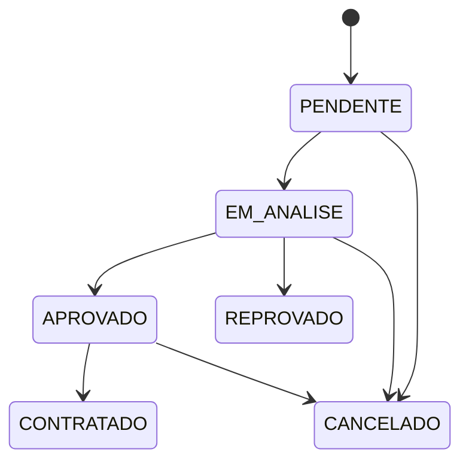
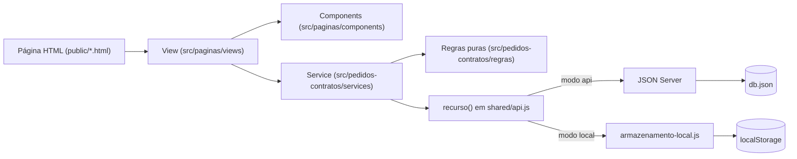
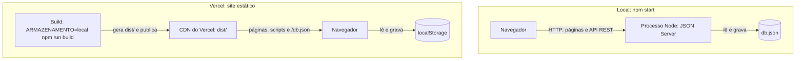
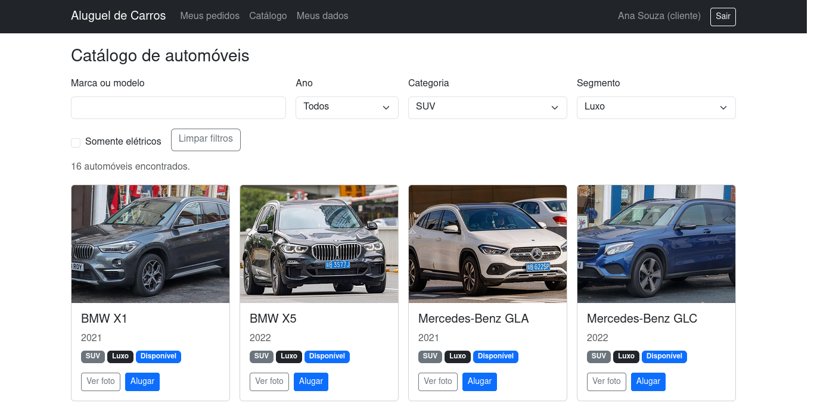
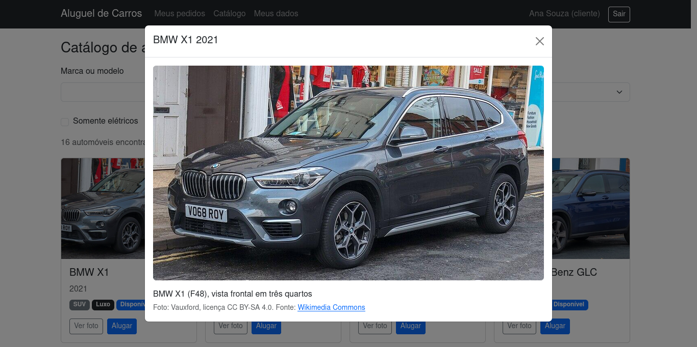

# Sistema de Aluguel de Carros

> LAB02 da disciplina Desenvolvimento de Interfaces Web (PUC Minas), 15 pontos.

| Disciplina | Professor | Curso |
|------------|-----------|-------|
| Desenvolvimento de Interfaces Web | João Paulo Carneiro Aramuni | Engenharia de Software, 2º semestre |

## Status do Projeto

Concluído e publicado: https://aluguel-de-carros-rosy.vercel.app (veja as [limitações da publicação](#limitações-da-publicação)). Modelagem, cadastro e login simulado, CRUD de Cliente, catálogo de 66 automóveis com filtros e fotos, pedidos, avaliação por Agentes e contratos. 112 testes automatizados passando (`npm test`).

## Índice

- [Links Úteis](#links-úteis)
- [Sobre o Projeto](#sobre-o-projeto)
- [Funcionalidades Principais](#funcionalidades-principais)
- [Tecnologias Utilizadas](#tecnologias-utilizadas)
- [Arquitetura](#arquitetura)
  - [Visão geral e fluxo entre camadas](#visão-geral-e-fluxo-entre-camadas)
  - [Subsistemas e classes do UML](#subsistemas-e-classes-do-uml)
  - [Dois modos de armazenamento](#dois-modos-de-armazenamento)
  - [Visão de implantação](#visão-de-implantação)
  - [Diagramas e decisões](#diagramas-e-decisões)
- [Instalação e Execução](#instalação-e-execução)
- [Deploy](#deploy)
  - [O problema do JSON Server e como foi resolvido](#o-problema-do-json-server-e-como-foi-resolvido)
  - [Como o deploy está configurado](#como-o-deploy-está-configurado)
  - [Refazer o deploy](#refazer-o-deploy)
  - [Limitações da publicação](#limitações-da-publicação)
- [Estrutura de Pastas](#estrutura-de-pastas)
- [Demonstração](#demonstração)
- [Testes](#testes)
- [Documentações utilizadas](#documentações-utilizadas)
- [Autores](#autores)
- [Contribuição](#contribuição)
- [Agradecimentos](#agradecimentos)
- [Licença](#licença)
- [Estratégia de branches](#estratégia-de-branches)
- [Histórico de alterações](#histórico-de-alterações)

## Links Úteis

- Produção (Vercel): https://aluguel-de-carros-rosy.vercel.app
- Repositório: https://github.com/Arthur-Bicalho/DIW-Lab2
- Glossário do domínio: [GLOSSARY.md](GLOSSARY.md)
- Especificação: [docs/SPEC.md](docs/SPEC.md)
- Decisões de arquitetura: [docs/adr](docs/adr) (lista na seção [Diagramas e decisões](#diagramas-e-decisões))
- O problema do JSON Server no Vercel: [seção do Deploy](#o-problema-do-json-server-e-como-foi-resolvido)
- Progresso, checklist de requisitos e roteiro da apresentação: [docs/PROGRESSO.md](docs/PROGRESSO.md)
- Créditos das fotos do catálogo: [docs/CREDITOS-IMAGENS.md](docs/CREDITOS-IMAGENS.md)
- Diagramas UML (Mermaid, renderizados pelo GitHub):
  - [Casos de uso](docs/diagramas/casos-de-uso.md)
  - [Histórias de usuário](docs/historias-de-usuario.md)
  - [Classes e estados do Pedido](docs/diagramas/classes.md)
  - [Pacotes](docs/diagramas/pacotes.md)
  - [Componentes e visão de implantação](docs/diagramas/componentes.md)

Não há aplicativo móvel; o layout é responsivo e funciona no navegador do celular.

## Sobre o Projeto

Sistema web para gerenciar aluguéis de automóveis. O Cliente escolhe um carro no catálogo e cria um Pedido de aluguel; pode modificá-lo ou cancelá-lo pela Internet. Depois de enviado, o Pedido passa por uma análise financeira feita por um Agente (Empresa ou Banco); com Parecer positivo, fica disponível para a execução do Contrato, que pode incluir um Contrato de Crédito concedido por um Banco.

A arquitetura é cliente-servidor: um servidor central (JSON Server) acessado pelos navegadores de clientes e agentes. O código se divide nos dois subsistemas pedidos no enunciado: gestão de pedidos e contratos, e construção dinâmica das páginas web.

O sistema roda de dois modos, com o mesmo código de telas e regras: localmente com o JSON Server (dados em `db.json`) e publicado no Vercel como site estático (dados no `localStorage` de cada navegador). O motivo está na seção [O problema do JSON Server e como foi resolvido](#o-problema-do-json-server-e-como-foi-resolvido).

O uso exige cadastro prévio e login com senha conferida (RF01). O login é **simulado**: os usuários ficam no `db.json` com senha em texto puro e a sessão no `sessionStorage`. Não é autenticação real, e nenhum servidor impõe autorização; as permissões por perfil valem apenas na interface ([ADR 0004](docs/adr/0004-login-simulado-e-perfis.md)).

## Funcionalidades Principais

**Cliente (pessoa física)**
- Cadastro público com RG, CPF, nome, endereço, profissão e até 3 entidades empregadoras, cada uma com rendimento.
- Consulta, alteração e exclusão dos próprios dados (CRUD de Cliente). A exclusão é recusada se houver Pedido em andamento.
- Catálogo de automóveis (detalhado abaixo).
- Criação de Pedidos de aluguel (Automóvel e período), consulta de status e Parecer, modificação (somente PENDENTE) e cancelamento (até APROVADO).
- Consulta do Contrato do Pedido, com a propriedade do automóvel e o crédito.

**Catálogo de automóveis (Cliente)**
- 66 automóveis, modelos de 2019 a 2024 (a regra de inclusão é no máximo 10 anos, ou seja, 2016 em diante) (41 populares, 25 de luxo, 13 elétricos), cada um com uma foto do Wikimedia Commons e o crédito do autor ([ADR 0011](docs/adr/0011-classificacao-dos-automoveis-e-fotos.md), [créditos](docs/CREDITOS-IMAGENS.md)).
- Classificação em três campos independentes: `categoria` (carroceria: Hatch, Sedan, SUV, Picape, Minivan, Esportivo), `segmento` (Popular ou Luxo) e `eletrico`. Assim um luxo ou um popular pode ser elétrico.
- Filtros por modelo (sem diferenciar acento nem maiúscula), ano, categoria, segmento e somente elétricos; lista paginada, 12 carros por página.
- "Ver foto" amplia a imagem com o crédito; "Alugar" abre o Pedido já com o carro escolhido.
- Um carro com Pedido ativo aparece como Indisponível. A disponibilidade considera o Pedido ativo, não a sobreposição de datas.

**Empresa e Banco (Agentes)**
- Lista de Pedidos com filtro por status e consulta dos Clientes.
- Início da análise de um Pedido PENDENTE, que passa a EM_ANALISE e fica atribuído ao Agente.
- Avaliação com vista dos rendimentos e Parecer com justificativa: positivo aprova, negativo reprova.
- Modificação de Pedidos PENDENTE ou EM_ANALISE.
- Execução do Contrato de Pedido APROVADO, escolhendo o Tipo de Propriedade do Automóvel (Cliente, Empresa ou Banco).

**Somente Banco**
- Concessão de Contrato de Crédito (valor, parcelas e juros mensais) ao firmar o Contrato.

### Fluxo de status do Pedido



O fluxo separa EM_ANALISE de PENDENTE para registrar qual Agente assumiu o Pedido e impedir avaliações concorrentes, e só permite cancelar antes da execução do Contrato, como diz o enunciado. Justificativa completa em [ADR 0001](docs/adr/0001-fluxo-de-status-do-pedido.md) e [ADR 0002](docs/adr/0002-agente-avalia-pedidos.md).

## Tecnologias Utilizadas

### Front-end
- HTML5, CSS3 e JavaScript puro com módulos ES, sem frameworks.
- Bootstrap 5.3 via CDN.
- Fetch API, centralizada em `src/shared/api.js`.

### Back-end
- JSON Server 1.0.0-beta.15 como API REST simulada, persistindo em `db.json` e servindo os arquivos estáticos. É dependência de desenvolvimento (`devDependencies`): só é usado no modo local. No Vercel não há back-end; o armazenamento é o `localStorage` do navegador.

### Mobile (Opcional)
Não se aplica. O layout é responsivo (Bootstrap), sem aplicativo nativo.

### Infraestrutura & DevOps
- Node.js 22.12 ou superior (exigência do JSON Server) e npm; testes com o executor nativo `node --test`.
- Vercel: site estático gerado por `scripts/build.js`, publicado com `npx vercel --prod` (o repositório está conectado ao projeto).
- Git e GitHub: Issues, Pull Requests e merge sem squash.

## Arquitetura

### Visão geral e fluxo entre camadas

Cada página HTML carrega um módulo de view. A view monta a tela com components e chama services; os services aplicam as regras puras e só falam com os dados por `recurso()`, de `src/shared/api.js`.



A lógica de negócio fica em módulos puros (`regras`), sem DOM, e é testada com `node --test`. Todas as chamadas de dados passam pelos services; falhas aparecem em alertas Bootstrap.

### Subsistemas e classes do UML

As pastas de `src/` espelham os diagramas de pacotes e de componentes.

| Subsistema (enunciado) | Pasta | Papel |
|------------------------|-------|-------|
| Gestão de pedidos e contratos | `src/pedidos-contratos` | `models` (constantes), `regras` (funções puras: validações, transições, permissões, filtro do catálogo), `services` (acesso aos dados) |
| Construção dinâmica das páginas | `src/paginas` | `views` (uma por tela) e `components` (peças reutilizáveis) |
| Infraestrutura comum | `src/shared` | `api.js` (Fetch e `recurso()`), `armazenamento-local.js`, `modo.js`, `erro-api.js`, `sessao.js`, `alertas.js` |

| Classe do diagrama de classes | Onde está no código |
|-------------------------------|---------------------|
| Usuario, Cliente, EntidadeEmpregadora | `regras/cliente.js`, `services/clienteService.js`, `services/usuarioService.js` |
| Agente, Empresa, Banco | perfis em `models/constantes.js`; permissões em `regras/permissoes.js` |
| Pedido, Parecer | `regras/pedido.js`, `services/pedidoService.js` |
| Contrato, ContratoCredito | `regras/contrato.js`, `services/contratoService.js` |
| Automovel (inclui `categoria`, `segmento`, `eletrico` e `imagem`) | `models/constantes.js` (valores de categoria e segmento), `regras/automovel.js` (filtro, paginação, descrição), `services/automovelService.js`; dados e fotos em `db.json` e `public/img/carros/` |

### Dois modos de armazenamento

`src/shared/modo.js` exporta a constante `ARMAZENAMENTO`, e `recurso(nome)` em `src/shared/api.js` escolhe o que usar. Os services, as views e as regras não mudam entre os modos: todos têm a mesma interface (`listar`, `obter`, `criar`, `atualizar`, `remover`).

| Modo | Quando | Onde ficam os dados |
|------|--------|---------------------|
| `api` (padrão) | `npm start` | JSON Server grava em `db.json`; todos os navegadores compartilham os dados |
| `local` | build do Vercel (`ARMAZENAMENTO=local npm run build`) | `localStorage` de cada navegador (chaves `aluguel:v1:<coleção>`), com `/db.json` como semente na primeira leitura ([ADR 0010](docs/adr/0010-armazenamento-no-navegador-no-vercel.md)) |

O build troca o conteúdo de `modo.js` apenas em `dist/`; o arquivo do repositório continua com `'api'`.

### Visão de implantação



No Vercel não existe processo do servidor: só arquivos estáticos. Versão detalhada em [docs/diagramas/componentes.md](docs/diagramas/componentes.md#visão-de-implantação).

### Diagramas e decisões

| Diagrama | Arquivo |
|----------|---------|
| Casos de uso | [docs/diagramas/casos-de-uso.md](docs/diagramas/casos-de-uso.md) |
| Histórias de usuário | [docs/historias-de-usuario.md](docs/historias-de-usuario.md) |
| Classes e estados do Pedido | [docs/diagramas/classes.md](docs/diagramas/classes.md) |
| Pacotes | [docs/diagramas/pacotes.md](docs/diagramas/pacotes.md) |
| Componentes e implantação | [docs/diagramas/componentes.md](docs/diagramas/componentes.md) |

Os diagramas são mantidos junto com o código: toda mudança de estrutura atualiza o diagrama afetado e entra no [histórico de alterações](#histórico-de-alterações).

| ADR | Título | Status |
|-----|--------|--------|
| [0000](docs/adr/0000-skills-ausentes.md) | Skills de planejamento indisponíveis | aceita |
| [0001](docs/adr/0001-fluxo-de-status-do-pedido.md) | Fluxo de status do Pedido | aceita |
| [0002](docs/adr/0002-agente-avalia-pedidos.md) | Qual Agente avalia qual Pedido | aceita |
| [0003](docs/adr/0003-propriedade-e-contratos.md) | Tipo de Propriedade e Contrato de Crédito | aceita |
| [0004](docs/adr/0004-login-simulado-e-perfis.md) | Login simulado e permissões por perfil | aceita |
| [0005](docs/adr/0005-uml-em-mermaid.md) | Diagramas em Mermaid | aceita |
| [0006](docs/adr/0006-regras-por-conceito-do-dominio.md) | Regras organizadas por conceito do domínio | aceita |
| [0007](docs/adr/0007-filtros-no-cliente.md) | Filtros aplicados no cliente | aceita |
| [0008](docs/adr/0008-dialogos-como-componentes.md) | Diálogos do Agente como componentes | aceita |
| [0009](docs/adr/0009-deploy-vercel-json-server-em-funcao.md) | Deploy na Vercel com JSON Server em função | substituída pela 0010 |
| [0010](docs/adr/0010-armazenamento-no-navegador-no-vercel.md) | Armazenamento no navegador na publicação da Vercel | aceita |
| [0011](docs/adr/0011-classificacao-dos-automoveis-e-fotos.md) | Classificação dos automóveis e fotos no catálogo | aceita |

## Instalação e Execução

### Pré-requisitos
- Node.js 22.12 ou superior e npm (confira com `node -v`).
- Git e um navegador atual.

### Variáveis de Ambiente
Nenhuma para rodar localmente. A API roda em `http://localhost:3000`. A variável `ARMAZENAMENTO=local` só é usada no build para o modo navegador (veja [Deploy](#deploy)).

### Instalação de Dependências

```bash
git clone https://github.com/Arthur-Bicalho/DIW-Lab2.git
cd DIW-Lab2
npm install
```

### Inicialização do Banco de Dados
O banco é o arquivo `db.json`, versionado com dados de exemplo (3 clientes, 1 empresa, 2 bancos, 66 automóveis, 6 pedidos em todos os status e 1 contrato). O JSON Server grava nele a cada alteração. Para voltar ao estado inicial depois de testar: `git checkout db.json`.

### Como Executar a Aplicação

```bash
npm start
```

O comando sobe o JSON Server em `http://localhost:3000`, que serve a API (`/usuarios`, `/automoveis`, `/pedidos`, `/contratos`) e as páginas. Abra http://localhost:3000/public/login.html.

Usuários de exemplo (senha `123456` para todos):

| Perfil | E-mail |
|--------|--------|
| Cliente | ana@email.com, bruno@email.com, carla@email.com |
| Empresa | veloz@empresa.com |
| Banco | horizonte@banco.com, meridional@banco.com |

Também é possível criar um Cliente em `public/cadastro.html`. Para ver o lado do Agente (avaliar, firmar contrato), entre com a Empresa ou um Banco de exemplo.

Para rodar os testes: `npm test`.

### Testar o modo navegador localmente

Para reproduzir o que o Vercel publica, gere o build e sirva `dist/` com qualquer servidor estático. Por exemplo, com Python (sem adicionar dependências ao projeto):

```bash
ARMAZENAMENTO=local npm run build
python3 -m http.server -d dist 8080
```

Abra http://localhost:8080/public/login.html. As páginas ficam em `/public/...`, como no `npm start`; a raiz `/` só redireciona no Vercel (regra do `vercel.json`). Os dados desse modo ficam no `localStorage` do navegador, nunca no `db.json`.

### Solução de problemas

| Sintoma | Causa e solução |
|---------|-----------------|
| `EADDRINUSE` ou porta 3000 ocupada | Outro processo usa a porta. Encerre-o e rode `npm start` de novo. |
| Erro de versão ou de sintaxe ao subir o JSON Server | Node antigo. Atualize para 22.12 ou superior. |
| Dados estranhos ou pedidos que você não criou | O `db.json` foi alterado em testes anteriores. Restaure com `git checkout db.json`. |
| "Não foi possível conectar ao servidor" na tela | O JSON Server não está rodando (modo `api`). Rode `npm start`. |
| Dados do modo navegador sumiram ou corrompidos | Use "Limpar dados do site" do navegador para voltar aos dados de exemplo. |

## Deploy

Produção: https://aluguel-de-carros-rosy.vercel.app (projeto `aluguel-de-carros`). O repositório do GitHub está conectado ao projeto no Vercel (`vercel link`); os deploys de produção deste trabalho foram feitos com `npx vercel --prod --yes`. A publicação é um site estático com os dados no navegador de cada visitante.

### O problema do JSON Server e como foi resolvido

O enunciado exige JSON Server. Ele funciona bem localmente, mas não no Vercel. A história, em ordem:

1. **O problema de fundo.** O JSON Server é um processo Node que fica ativo e grava no arquivo `db.json`. O Vercel não oferece nem processo permanente nem disco gravável, então `npm start` não pode rodar lá.
2. **Tentativa 1: JSON Server dentro de uma Vercel Function** ([ADR 0009](docs/adr/0009-deploy-vercel-json-server-em-funcao.md), PR [#28](https://github.com/Arthur-Bicalho/DIW-Lab2/pull/28)). A API virou uma função que criava o mesmo JSON Server em memória, com o `db.json` como semente, e rewrites levavam `/usuarios`, `/pedidos` e as demais rotas até ela. Em produção apareceram três problemas:
   - O JSON Server escaneia a pasta `public` quando `NODE_ENV=production`, e a Function não a continha: toda chamada quebrava com `ENOENT`. Corrigido incluindo a pasta com `includeFiles` (Issue [#29](https://github.com/Arthur-Bicalho/DIW-Lab2/issues/29), PR [#30](https://github.com/Arthur-Bicalho/DIW-Lab2/pull/30)).
   - O rewrite do Vercel anexa os parâmetros `recurso` e `resto` à query string; o JSON Server os tratava como filtros e as listagens voltavam vazias. Corrigido removendo esses parâmetros (Issue [#31](https://github.com/Arthur-Bicalho/DIW-Lab2/issues/31), PR [#32](https://github.com/Arthur-Bicalho/DIW-Lab2/pull/32)).
   - O problema sem conserto: cada instância da Function tinha os próprios dados em memória. Um cadastro e o login seguinte podiam cair em instâncias diferentes, e o login falhava (em uma verificação manual em produção, 2 de 3 logins logo após o cadastro falharam; 12 leituras seguidas de `/pedidos` no navegador devolveram 6 itens enquanto o `curl` devolveu 7), além de os dados voltarem à semente a cada cold start.
3. **Solução final: build estático com os dados no `localStorage`** ([ADR 0010](docs/adr/0010-armazenamento-no-navegador-no-vercel.md), Issue [#33](https://github.com/Arthur-Bicalho/DIW-Lab2/issues/33)). No build do Vercel, `ARMAZENAMENTO=local` faz `recurso()` usar `armazenamento-local.js`, com a mesma interface do modo `api`, e o `db.json` serve só de semente. O ADR 0009 ficou "substituída"; a Function, os rewrites e as pastas `api/` e `servidor/` foram removidos. Localmente o JSON Server continua sendo a API, como exige o enunciado.
4. **Outros dois problemas do JSON Server, que continuam tratados** em qualquer modo:
   - A página `pedidos.html` colidia com a rota `/pedidos` da API (o JSON Server serviria o HTML no lugar dos dados); por isso a página do Cliente se chama `meus-pedidos.html`.
   - O filtro por campos numéricos (`?clienteId=1`) não casa ids em texto; por isso `recurso.listar` busca a coleção e filtra no cliente ([ADR 0007](docs/adr/0007-filtros-no-cliente.md)).

Honestidade sobre o processo: a entrega do armazenamento no navegador (Issue #33, commits `a8ca298` e `77c0b40`) entrou direto na `main`, sem Pull Request, por erro de processo. Depois, uma etapa de "login sem cadastro" (Issue [#34](https://github.com/Arthur-Bicalho/DIW-Lab2/issues/34)) foi proposta e cancelada para manter o RF01 (cadastro e login prévios).

### Como o deploy está configurado

`vercel.json`:

```json
{
  "buildCommand": "ARMAZENAMENTO=local npm run build",
  "outputDirectory": "dist",
  "redirects": [
    { "source": "/", "destination": "/public/login.html", "permanent": false }
  ]
}
```

`scripts/build.js` apaga e recria `dist/`, copia `public/` e `src/` e, quando `ARMAZENAMENTO=local`, grava `dist/src/shared/modo.js` com `'local'` e copia `db.json` para `dist/db.json` (a semente). As URLs e os imports absolutos são os mesmos do modo local.

### Refazer o deploy

Para publicar de novo, ou em outra conta do Vercel:

```bash
npx vercel login
npx vercel link
npx vercel --prod
```

No `vercel link`, informe o nome do projeto em minúsculas: a pasta do repositório se chama `DIW-Lab2`, com maiúsculas, e o Vercel exige nome de projeto em minúsculas. O `vercel link` conecta o repositório do GitHub ao projeto (a CLI informa "Connected"); os deploys de produção deste trabalho foram feitos com `npx vercel --prod --yes`.

### Limitações da publicação

- Os dados ficam por navegador: cada visitante vê só os próprios dados, e o cadastro feito num navegador não existe em outro.
- Não há compartilhamento entre pessoas: um Cliente e um Agente em máquinas diferentes não veem os Pedidos um do outro.
- Limpar os dados do site apaga tudo; não há tela de restaurar. Use "Limpar dados do site" do navegador para voltar aos dados de exemplo.
- Para ver o lado do Agente no site publicado, entre com a Empresa ou um Banco de exemplo (senha `123456`) no mesmo navegador.
- O `localStorage` tem cerca de 5 MB; se estiver cheio ou bloqueado, a tela mostra um alerta com a causa.

## Estrutura de Pastas

```text
.
├── db.json                          # banco do modo local e semente do modo navegador
├── vercel.json                      # build, pasta publicada e redirect da raiz
├── package.json                     # scripts start, build e test; json-server em devDependencies
├── GLOSSARY.md                      # linguagem do domínio
├── scripts/
│   └── build.js                     # gera dist/ (public, src e, no modo local, db.json)
├── public/                          # páginas HTML
│   ├── index.html                   # redireciona para login.html
│   ├── login.html, cadastro.html    # acesso
│   ├── clientes.html                # dados do Cliente (CRUD) e consulta pelo Agente
│   ├── catalogo.html                # catálogo com filtros e fotos
│   ├── meus-pedidos.html            # pedidos do Cliente
│   ├── avaliacao.html               # pedidos e contratos do Agente
│   └── img/carros/                  # 66 fotos dos automóveis (Wikimedia Commons)
├── src/
│   ├── shared/                      # infraestrutura comum
│   │   ├── api.js                   # Fetch, requisitar() e recurso() (escolhe o modo)
│   │   ├── modo.js                  # constante ARMAZENAMENTO ('api' no repositório)
│   │   ├── armazenamento-local.js   # recursoLocal() sobre o localStorage
│   │   ├── erro-api.js              # ErroApi
│   │   ├── sessao.js                # sessão no sessionStorage
│   │   └── alertas.js               # alertas Bootstrap
│   ├── pedidos-contratos/           # subsistema: gestão de pedidos e contratos
│   │   ├── models/                  # constantes.js
│   │   ├── regras/                  # cliente, pedido, contrato, automovel, permissoes, formatacao, erros
│   │   └── services/                # cliente, usuario, pedido, contrato e automovel
│   └── paginas/                     # subsistema: construção dinâmica das páginas
│       ├── views/                   # login, cadastro, clientes, catalogo, pedidos, avaliacao
│       └── components/              # navbar, guarda, tabela, formulário, campos, diálogos,
│                                    # cartaoAutomovel, fotoAmpliada, paginacao, statusPedido
├── tests/                           # node --test (um arquivo por módulo de regras ou service)
│   └── apoio/bancoFalso.js          # JSON Server simulado em memória
└── docs/                            # SPEC, ADRs, diagramas, histórias, créditos, capturas, PROGRESSO
    ├── adr/                         # ADRs 0000 a 0011
    ├── diagramas/                   # casos de uso, classes, pacotes, componentes
    └── capturas/                    # imagens da seção Demonstração
```

O diretório `dist/` é gerado pelo build e fica fora do Git. A página do Cliente se chama `meus-pedidos.html` porque o JSON Server serviria `public/pedidos.html` em `/pedidos`, escondendo a API.

## Demonstração

### Aplicativo Mobile
Não se aplica.

### Aplicação Web

Catálogo (Cliente `ana@email.com`):

| Tela | Captura |
|------|---------|
| Catálogo com filtros Luxo e SUV aplicados (1280 px) |  |
| Catálogo no celular (390 px), filtro Somente elétricos |  |
| Foto ampliada com o crédito do autor |  |

Demais telas (capturas anteriores à ampliação do catálogo; a barra de navegação do Cliente agora também tem o link Catálogo):

| Tela | Captura |
|------|---------|
| Meus dados (Cliente) |  |
| Validação do formulário de Cliente |  |
| Pedidos do Cliente, com contrato |  |
| Lista de Pedidos do Agente |  |
| Parecer sem justificativa |  |
| Contrato de Crédito (Banco) |  |

### Exemplo de Saída no Terminal

#### 1. Demonstração da API (modo local, com `npm start` ativo)

```bash
curl http://localhost:3000/pedidos/5
```

Devolve o Pedido 5 (CONTRATADO) em JSON.

#### 2. Demonstração de Execução de CLI/Script

```bash
npm test
```

Executa os 112 testes e termina com `fail 0`.

## Testes

### Testes Unitários e de Integração
`npm test` roda `node --test` sobre `tests/` (13 arquivos, 112 testes):
- regras puras: CPF, campos obrigatórios, limite de 3 entidades empregadoras, transições de status, permissões por perfil, Parecer, Contrato e Contrato de Crédito, filtro e paginação do catálogo;
- serviços, com um JSON Server simulado em memória (`tests/apoio/bancoFalso.js`), cobrindo duplicidade de CPF e e-mail, disponibilidade do Automóvel, autorização por Agente e um Contrato por Pedido;
- `api.js` e `armazenamento-local.js` (o modo navegador, com `localStorage` simulado);
- `dados.test.js`, que confere a integridade do `db.json` (frota, classificação e fotos).

### Testes End-to-End (E2E)
Não há suíte E2E automatizada. Os fluxos de tela (cadastro, login, guarda de rota, catálogo, pedidos, avaliação e contratos) foram verificados manualmente no navegador a cada branch, e as capturas ficam em `docs/capturas`.

### Limitações conhecidas
- Login simulado, sem autorização no servidor.
- O JSON Server v1 não casa filtros numéricos com ids em texto, por isso `recurso.listar` filtra no cliente ([ADR 0007](docs/adr/0007-filtros-no-cliente.md)).
- Sem controle de versão nem transações: dois Agentes que iniciam a análise ao mesmo tempo podem se sobrescrever, e `firmar` grava Contrato, Pedido e Automóvel em três chamadas.
- A disponibilidade do Automóvel considera Pedido ativo, não sobreposição de datas.
- Na publicação, os dados ficam só no navegador de cada visitante ([limitações da publicação](#limitações-da-publicação)).

## Documentações utilizadas

- [Bootstrap 5.3](https://getbootstrap.com/docs/5.3/)
- [JSON Server](https://github.com/typicode/json-server)
- [Fetch API (MDN)](https://developer.mozilla.org/pt-BR/docs/Web/API/Fetch_API)
- [Web Storage API (MDN)](https://developer.mozilla.org/pt-BR/docs/Web/API/Web_Storage_API)
- [Executor de testes do Node.js](https://nodejs.org/api/test.html)
- [Vercel: configuração do projeto (`vercel.json`)](https://vercel.com/docs/project-configuration)
- [Mermaid](https://mermaid.js.org/)
- [Wikimedia Commons](https://commons.wikimedia.org/) (fotos dos automóveis)

## Autores

| Nome | GitHub |
|------|--------|
| Arthur Bicalho | [@Arthur-Bicalho](https://github.com/Arthur-Bicalho) |

## Contribuição

1. Faça um fork e crie uma branch a partir de `main` (`feature/...`, `docs/...`, `refactor/...`, `fix/...`).
2. Commits em português seguindo Conventional Commits, por exemplo `feat(pedido): adiciona cancelamento`.
3. Atualize o diagrama afetado na mesma branch.
4. Rode `npm test` e abra um Pull Request que feche a Issue correspondente.

## Agradecimentos

Ao professor João Paulo Carneiro Aramuni, pelo enunciado e pelo template de documentação.

## Licença

MIT.

## Estratégia de branches

`main` permanece estável. Cada entrega tem uma Issue e uma branch criada a partir de `main` atualizada, com Pull Request que fecha a Issue e merge sem squash (o histórico mostra a evolução dos modelos e do código); a branch é apagada depois do merge.

Prefixos: `docs/` (modelagem e documentação), `feature/` (funcionalidades), `refactor/` (revisões de arquitetura) e `fix/` (correções).

Exceção registrada: os commits `a8ca298` e `77c0b40` (armazenamento no navegador, Issue #33) foram para a `main` sem Pull Request, por erro de processo.

## Histórico de alterações

| PR | Branch | Mudança | Diagramas afetados |
|----|--------|---------|--------------------|
| [#12](https://github.com/Arthur-Bicalho/DIW-Lab2/pull/12) | `docs/setup-projeto` | Especificação, `.gitignore`, ADR 0000 | nenhum |
| [#13](https://github.com/Arthur-Bicalho/DIW-Lab2/pull/13) | `docs/modelagem-casos-de-uso-historias` | Glossário, ADRs 0001 a 0005, casos de uso, histórias | casos de uso criado |
| [#14](https://github.com/Arthur-Bicalho/DIW-Lab2/pull/14) | `docs/diagrama-classes-pacotes` | Diagramas de classes e de pacotes | classes e pacotes criados |
| [#15](https://github.com/Arthur-Bicalho/DIW-Lab2/pull/15) | `docs/diagrama-componentes` | Diagrama de componentes | componentes criado |
| [#16](https://github.com/Arthur-Bicalho/DIW-Lab2/pull/16) | `feature/setup-json-server` | `package.json`, `db.json`, `shared/api.js`, constantes | nenhum |
| [#17](https://github.com/Arthur-Bicalho/DIW-Lab2/pull/17) | `feature/crud-cliente` | CRUD de Cliente, validações, serviço | nenhum |
| [#19](https://github.com/Arthur-Bicalho/DIW-Lab2/pull/19) | `refactor/arquitetura-cliente` | `validacoes.js` dividido em `cliente.js`, `erros.js` e `formatacao.js` (ADR 0006) | pacotes e componentes |
| [#20](https://github.com/Arthur-Bicalho/DIW-Lab2/pull/20) | `feature/autenticacao` | Cadastro, login simulado, guarda de rota, `permissoes.js` | pacotes e componentes |
| [#21](https://github.com/Arthur-Bicalho/DIW-Lab2/pull/21) | `feature/pedidos-cliente` | Pedidos do Cliente, `pedido.js`; filtros no cliente (ADR 0007); página `meus-pedidos` | pacotes e componentes |
| [#22](https://github.com/Arthur-Bicalho/DIW-Lab2/pull/22) | `feature/avaliacao-agente` | Avaliação, Parecer, modificação pelo Agente; componentes compartilhados | pacotes e componentes |
| [#23](https://github.com/Arthur-Bicalho/DIW-Lab2/pull/23) | `feature/contratos-credito` | Contrato, Contrato de Crédito, Tipo de Propriedade | pacotes e componentes |
| [#25](https://github.com/Arthur-Bicalho/DIW-Lab2/pull/25) | `refactor/arquitetura-prototipo` | Diálogos de avaliação e contrato como componentes (ADR 0008) | pacotes e componentes |
| [#26](https://github.com/Arthur-Bicalho/DIW-Lab2/pull/26) | `docs/readme` | README conforme o template, PROGRESSO.md e checklist | nenhum |
| [#28](https://github.com/Arthur-Bicalho/DIW-Lab2/pull/28) | `feature/deploy-vercel` | Deploy no Vercel: API em Vercel Function, build estático, `vercel.json`, testes da Function, ADR 0009 | componentes (visão de implantação) |
| [#30](https://github.com/Arthur-Bicalho/DIW-Lab2/pull/30) | `fix/function-pasta-public` | Inclui `public` na Function para o JSON Server iniciar em produção (`ENOENT`) | nenhum |
| [#32](https://github.com/Arthur-Bicalho/DIW-Lab2/pull/32) | `fix/rewrites-listagem` | Remove da query os parâmetros `recurso` e `resto` que o rewrite acrescenta (listagens vazias) | nenhum |
| sem PR | `main` (commits `a8ca298` e `77c0b40`) | Armazenamento no navegador no build do Vercel, remoção da Function, `api/` e `servidor/` (Issue #33, ADR 0010); entrou direto na `main` por erro de processo | pacotes e componentes |
| [#38](https://github.com/Arthur-Bicalho/DIW-Lab2/pull/38) | `feature/catalogo-automoveis` | Catálogo de automóveis com filtros, foto e paginação; classificação (ADR 0011) | casos de uso, classes, pacotes e componentes; histórias |
| [#39](https://github.com/Arthur-Bicalho/DIW-Lab2/pull/39) | `feature/frota-ampliada` | Frota de 66 automóveis, modelos de 2019 a 2024 (regra de inclusão: no máximo 10 anos, 2016 em diante), uma foto por carro, créditos das imagens | nenhum |
| PR desta entrega | `docs/readme-deploy` | README completo, deploy estático, PROGRESSO.md, capturas do catálogo (Issue #37) | nenhum |

A etapa "login sem cadastro" (Issue #34) foi proposta e cancelada para manter o RF01; não houve código nem Pull Request.
