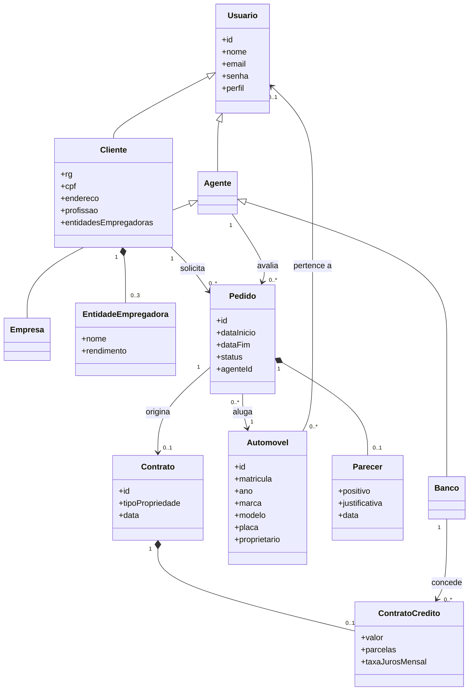
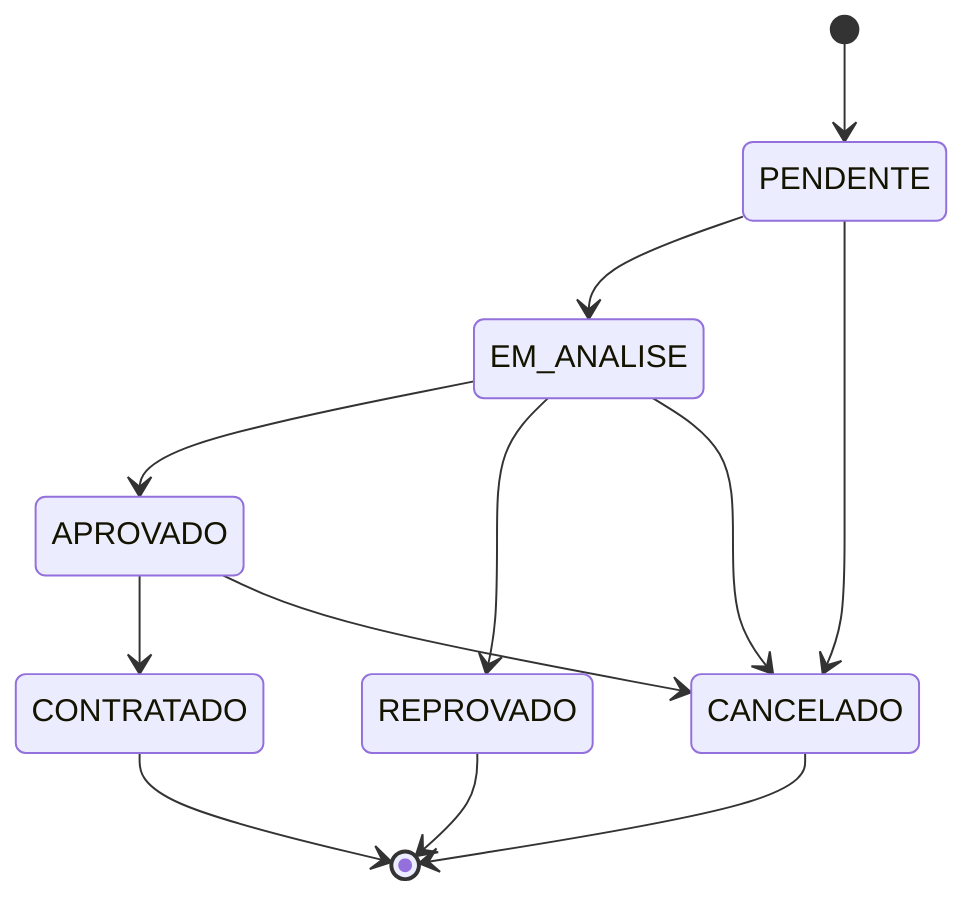

# Diagrama de Classes

Cliente, Empresa e Banco herdam de Usuário (Empresa e Banco por meio de Agente). No `db.json` todos os Usuários ficam na coleção `usuarios`, distinguidos pelo campo `perfil`. O Parecer fica dentro do Pedido e o Contrato de Crédito dentro do Contrato.

## Estados do Pedido

