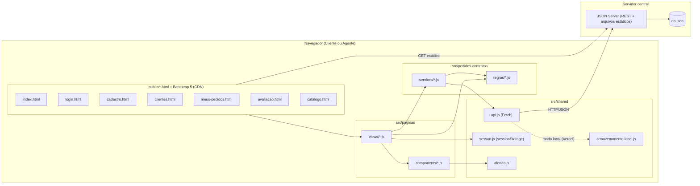
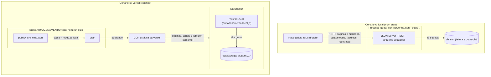

# Diagrama de Componentes

Visão de execução: o navegador carrega páginas HTML estáticas, cada uma com um módulo de view; as views usam serviços que falam com o JSON Server por Fetch. O JSON Server serve as páginas estáticas, expõe a API REST e persiste em `db.json`.

| Componente | Interface | Depende de |
|------------|-----------|------------|
| views | funções de inicialização por página | components, services, regras, sessao |
| components | `navbar`, `guarda` (exigirAcesso), `formulario`, `dialogoAvaliacao`, `dialogoContrato`, `tabela`, `statusPedido`, `camposCliente`, `camposPedido`, `entidadesEmpregadoras`, `cartaoAutomovel`, `fotoAmpliada`, `paginacao`: montam HTML Bootstrap e protegem páginas | alertas, sessao, regras/permissoes |
| services | `clienteService` (CRUD), `usuarioService.entrar`, `pedidoService` (criar, modificar, cancelar, iniciar análise, avaliar, listar por status), `contratoService` (firmar Contrato com Contrato de Crédito opcional), `automovelService` | regras, api |
| regras | funções puras de validação, formatação, transição, permissão e filtro/paginação do catálogo (`automovel.js`); `ErroValidacao` | models |
| api.js | `requisitar(caminho, opcoes)` com tratamento de erro; `recurso(nome)` com filtro no cliente (ADR 0007), que delega a `recursoLocal` quando `modo.js` define `'local'` | Fetch API, armazenamento-local, modo |
| armazenamento-local.js | `recursoLocal(nome)` com a mesma interface de `recurso` (listar, obter, criar, atualizar, remover) sobre o `localStorage`; `restaurarDadosDeExemplo()`; semente de `/db.json` (ADR 0010) | localStorage, Fetch API |
| `public/img/carros/` | fotos dos automóveis, servidas como arquivos estáticos (ADR 0011) | — |
| JSON Server | `/usuarios`, `/automoveis`, `/pedidos`, `/contratos` | db.json |

## Visão de implantação

O diagrama acima descreve a execução local (cenário A). A publicação na Vercel usa os mesmos componentes do navegador, mas sem servidor de dados: `recurso()` escolhe `recursoLocal` e os dados ficam no `localStorage` (ADR 0010).

| Aspecto | A: local | B: Vercel |
|---------|----------|-----------|
| Processo | um processo Node contínuo (`npm start`) | nenhum: só arquivos estáticos na CDN |
| Persistência | `db.json` em disco, compartilhado por todos os navegadores | `localStorage` de cada navegador; `/db.json` é só a semente da primeira leitura |
| Arquivos estáticos | servidos pelo JSON Server (`--static .`) | servidos pela CDN a partir de `dist/` |
| Para o usuário | dados permanecem entre execuções e são comuns a todos | cada visitante vê só os próprios dados; limpar os dados do site apaga tudo |
