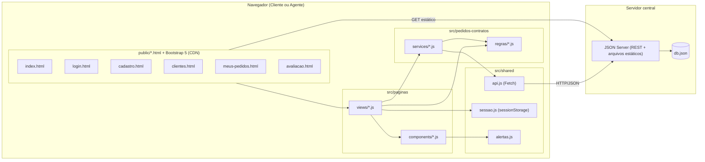
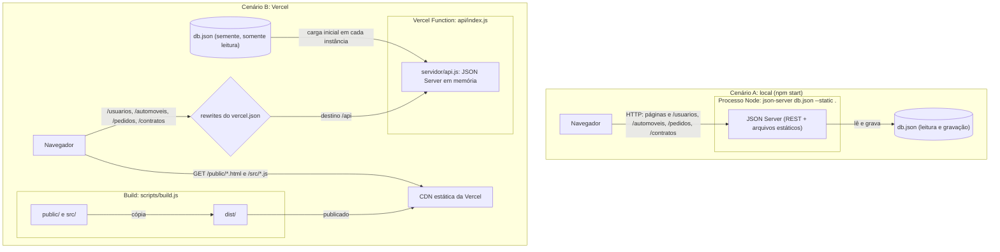

# Diagrama de Componentes

Visão de execução: o navegador carrega páginas HTML estáticas, cada uma com um módulo de view; as views usam serviços que falam com o JSON Server por Fetch. O JSON Server serve as páginas estáticas, expõe a API REST e persiste em `db.json`.

| Componente | Interface | Depende de |
|------------|-----------|------------|
| views | funções de inicialização por página | components, services, regras, sessao |
| components | `navbar`, `guarda` (exigirAcesso), `formulario`, `dialogoAvaliacao`, `dialogoContrato`, `tabela`, `statusPedido`, `camposCliente`, `camposPedido`, `entidadesEmpregadoras`: montam HTML Bootstrap e protegem páginas | alertas, sessao, regras/permissoes |
| services | `clienteService` (CRUD), `usuarioService.entrar`, `pedidoService` (criar, modificar, cancelar, iniciar análise, avaliar, listar por status), `contratoService` (firmar Contrato com Contrato de Crédito opcional), `automovelService` | regras, api |
| regras | funções puras de validação, formatação, transição e permissão; `ErroValidacao` | models |
| api.js | `requisitar(caminho, opcoes)` com tratamento de erro; `recurso(nome)` com filtro no cliente (ADR 0007) | Fetch API |
| JSON Server | `/usuarios`, `/automoveis`, `/pedidos`, `/contratos` | db.json |

## Visão de implantação

O diagrama acima descreve a execução local. A publicação na Vercel usa os mesmos componentes em outra implantação, descrita a seguir (ADR 0009).

| Aspecto | A: local | B: Vercel |
|---------|----------|-----------|
| Processo | um processo Node contínuo (`npm start`) | Vercel Function efêmera, criada sob demanda |
| Persistência | `db.json` em disco, gravado a cada alteração | memória da instância; `db.json` é só a semente e volta ao estado inicial em cold start |
| Arquivos estáticos | servidos pelo JSON Server (`--static .`) | servidos pela CDN a partir de `dist/` |
| Para o usuário | dados permanecem entre execuções | dados de demonstração; podem sumir ou diferir entre instâncias |
