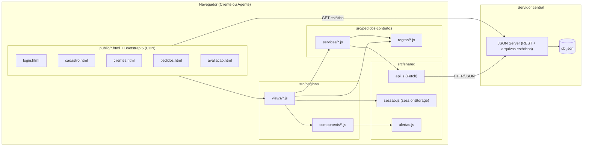

# Diagrama de Componentes

Visão de execução: o navegador carrega páginas HTML estáticas, cada uma com um módulo de view; as views usam serviços que falam com o JSON Server por Fetch. O JSON Server serve as páginas estáticas, expõe a API REST e persiste em `db.json`.

| Componente | Interface | Depende de |
|------------|-----------|------------|
| views | funções de inicialização por página | components, services, regras, sessao |
| components | funções que montam HTML Bootstrap | alertas |
| services | `listar`, `obter`, `criar`, `atualizar`, `remover` e operações de negócio | regras, api |
| regras | funções puras de validação, formatação, transição e permissão; `ErroValidacao` | models |
| api.js | `requisitar(caminho, opcoes)` com tratamento de erro | Fetch API |
| JSON Server | `/usuarios`, `/automoveis`, `/pedidos`, `/contratos` | db.json |
