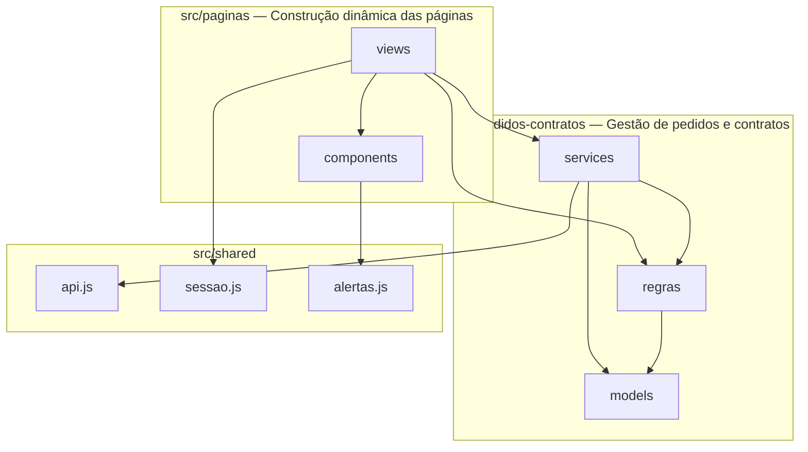

# Diagrama de Pacotes

Os pacotes correspondem às pastas de `src/`. O sistema se divide em dois subsistemas: gestão de pedidos e contratos (regras e acesso aos dados) e construção dinâmica das páginas (telas). O pacote `shared` oferece infraestrutura comum.

| Pacote | Conteúdo | Classes do diagrama de classes |
|--------|----------|-------------------------------|
| `pedidos-contratos/models` | Constantes de perfis, status e tipos de propriedade | Usuario, Pedido, Contrato (valores permitidos) |
| `pedidos-contratos/regras` | `cliente.js` (CPF, campos, limite de 3 entidades, rendimento total), `formatacao.js` (CPF, moeda, dígitos), `erros.js` (ErroValidacao), `permissoes.js` (acesso a páginas por perfil), `pedido.js` (transições de status, validação de período, disponibilidade do Automóvel, ações do Agente e validação do Parecer) | Cliente, EntidadeEmpregadora, Pedido, Parecer |
| `pedidos-contratos/services` | `clienteService`, `usuarioService`, `pedidoService`, `automovelService`: operações sobre a API | Usuario, Cliente, Automovel, Pedido, Contrato |
| `paginas/views` | Uma tela por arquivo | casos de uso UC01 a UC12 |
| `paginas/components` | Navbar, guarda de rota, tabela, selo de status, campos de Cliente e de Pedido, entidades empregadoras, erros de formulário | — |
| `shared` | Fetch, sessão e alertas | — |
